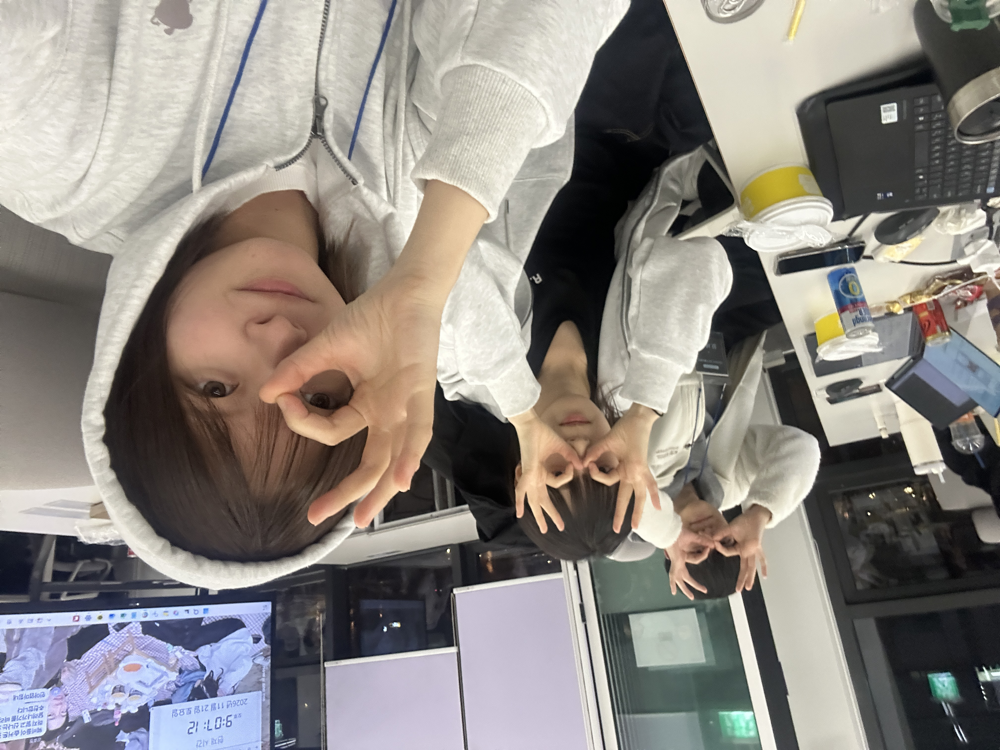
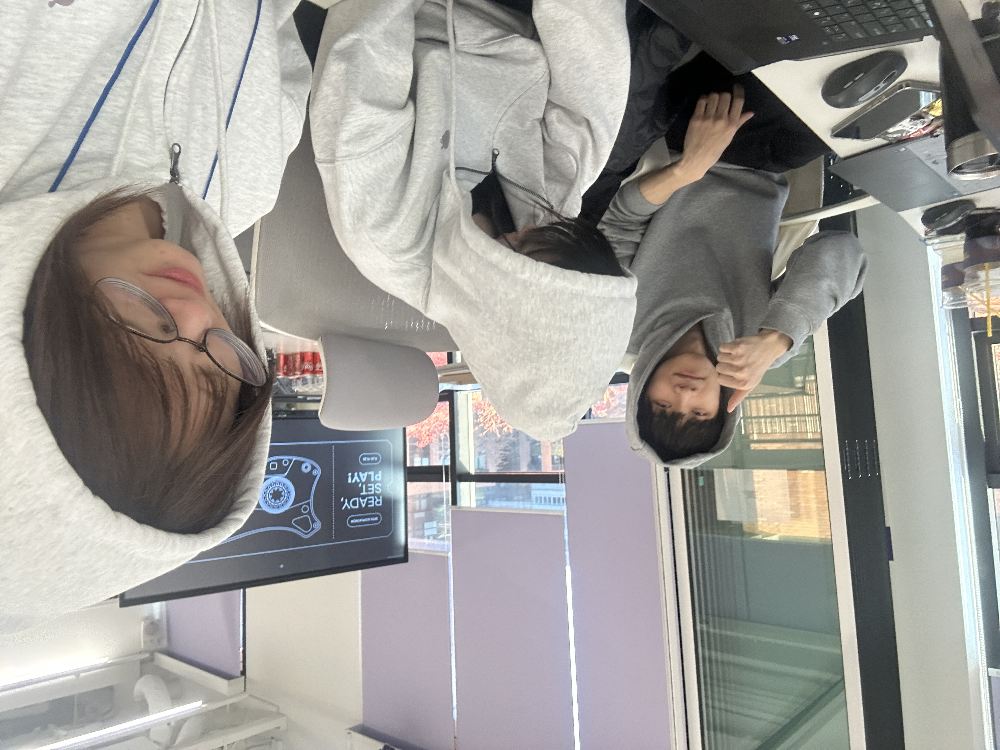

<div align="center">
  <h1>옛썰</h1>
  <strong>어르신의 추억이 아이들의 새로운 이야기가 되는 곳</strong>
  <br /><br />
  <p>
    옛썰은 어르신의 소중한 추억을 아이들의 새로운 이야기로 이어 주는<br />
    <strong>AI 기반 세대 연결 서비스</strong>입니다.
  </p>
  <p>
    어르신이 자신의 경험과 추억을 목소리로 들려주면,<br />
    AI가 이를 바탕으로 하나의 이야기 세계관을 생성합니다.<br />
    아이들은 AI와 대화하며 이야기를 직접 이어 나가고,<br />
    자연스럽게 어르신의 삶과 경험을 이해할 수 있습니다.
  </p>
</div>

<br />

## ✨ 옛썰 주요 기능

### 1️⃣ 어르신의 목소리로 만드는 AI 이야기 세계관

> 🗣️ **추억을 이야기로, 목소리를 세계관으로**

어르신이 자신의 경험과 추억을 녹음하면, 브라우저의 음성 인식으로 변환한 확정 원문을 바탕으로 AI가 이야기 초안을 생성합니다.
생성된 초안의 **제목, 카테고리, 배경, 인물, 사건을 직접 확인하고 수정**한 뒤, 이야기를 공개 등록할 수 있습니다.

### 2️⃣ AI와 함께 이어 가는 이야기 탐험

> 💬 **아이들의 선택으로 이어지는 새로운 이야기**

아이들은 다양한 세계관을 탐색하고 원하는 이야기를 선택할 수 있습니다.
선택한 세계관 속에서 AI와 채팅하며 다음 행동을 직접 입력하고, 자신의 선택에 따라 이야기를 이어 나갑니다.

맞춤법이나 문장 표현이 올바르지 않으면 **AI가 교정 피드백을 제공**하며, 문장을 수정한 뒤 다음 이야기로 진행할 수 있습니다.

<br />

## 👥 Team

<table align="center">
  <tr align="center">
    <td width="33%">
      <a href="https://github.com/YeBeenChoi">
        
        <br />
        <b>YeBeenChoi</b>
      </a>
    </td>
    <td width="33%">
      <a href="https://github.com/2516391">
        
        <br />
        <b>2516391</b>
      </a>
    </td>
    <td width="33%">
      <a href="https://github.com/comehere43">
        
        <br />
        <b>comehere43</b>
      </a>
    </td>
  </tr>
  <tr align="center">
    <td>
      최예빈 <br />
    </td>
    <td>
      김지영 <br />
    </td>
    <td>
      오세영 <br />
    </td>
  </tr>
  <tr align="center">
    <td>
      어르신 음성 녹음 기능 구현<br />
      음성 인식 결과 표시 및 재녹음 기능 구현<br />
      AI 세계관 생성 및 검토 페이지 구현<br />
      이야기 초안 생성 및 공개 확정 API 연동<br />
      초기 세팅, CI/CD 파이프라인 구현<br />
    </td>
    <td>
      공통 레이아웃 및 라우팅 구현<br />
      시작 화면 및 세계관 탐색 페이지 구현<br />
      세계관 목록 조회 및 상세 API 연동<br />
      배포 및 프로젝트 초기 환경 설정<br />
      디스코드 알림봇<br />
    </td>
    <td>
      어린이 AI 스토리 채팅 UI 구현<br />
      채팅 내역 조회 및 메시지 전송 API 연동<br />
      AI 맞춤법 교정 및 재입력 기능 구현<br />
      채팅 진행 상태 및 예외 처리<br />
      아이콘/이미지 저장 규칙 설정<br />
    </td>
  </tr>
</table>

## 🛠 기술 스택

| 구분               | 기술                                          |
| ------------------ | --------------------------------------------- |
| Frontend           | React · TypeScript · Vite                     |
| Routing            | React Router                                  |
| Styling            | Tailwind CSS · clsx · tailwind-merge          |
| API                | Axios                                         |
| Browser API        | Web Speech API · MediaRecorder · MediaDevices |
| Package Manager    | pnpm                                          |
| Code Quality       | ESLint · Prettier · Husky · lint-staged       |
| CI/CD & Deployment | GitHub Actions · Vercel                       |
| Collaboration      | Git · GitHub · Figma · Notion                 |

<br />

## 🚀 로컬 실행 방법

```bash
pnpm install
cp .env.example .env.local
pnpm dev
```

`.env.local`의 `VITE_API_BASE_URL`에 백엔드 서버 주소를 설정합니다. `.env.example`에는 현재 서버 주소가 포함되어 있습니다.
기존 `.env.local`이 있다면 파일을 덮어쓰지 않고 해당 변수만 추가하거나 수정합니다.
환경변수를 변경한 경우 개발 서버를 재시작합니다.

브라우저에서 `http://localhost:5173`에 접속합니다. 음성 인식은 Chrome에서 확인하며, 마이크 권한을 허용해야 합니다.
배포 환경의 마이크 사용에는 HTTPS가 필요합니다.

### 검증 명령어

```bash
pnpm lint
pnpm build
pnpm format:check
```

<br />

## 📄 컨벤션 및 브랜치 전략

[팀 컨벤션 문서 ↗](https://app.notion.com/p/SOPKATHON-WEB-1-41dc9258898d8036acb8f8aea51bc9f9?source=copy_link)

### 커밋 컨벤션

| 커밋 컨벤션 | 용도                          |
| ----------- | ----------------------------- |
| feat        | 새로운 기능 추가              |
| fix         | 버그 수정                     |
| refactor    | 기능 변경 없는 코드 구조 개선 |
| chore       | 프로젝트 설정 및 유지보수     |
| docs        | 문서 작성 및 수정             |
| style       | 코드 포맷 및 스타일 수정      |

커밋 메시지: `타입: 작업 내용 (#이슈번호)`

예시: `chore: Axios 공통 인스턴스 및 환경변수 설정 (#17)`

### 브랜치 전략

| 브랜치                   | 용도             |
| ------------------------ | ---------------- |
| main                     | 운영 배포        |
| dev                      | 개발 작업 통합   |
| feat/이슈번호-작업명     | 기능 개발        |
| fix/이슈번호-작업명      | 버그 수정        |
| refactor/이슈번호-작업명 | 리팩터링         |
| chore/이슈번호-작업명    | 설정 및 유지보수 |
| docs/이슈번호-작업명     | 문서 작업        |

<br />

작업 브랜치는 `dev`를 기준으로 생성하고, 작업 완료 후 `dev`로 PR을 작성합니다.
운영 배포는 `dev → main` PR로 진행합니다.

## 📁 프로젝트 구조

```text
📦 src/
├── pages/                  # 페이지별 UI, API, 훅, 타입
│   ├── home/               # 시작 화면 및 역할 선택
│   ├── recording/          # 음성 녹음 및 음성 인식
│   ├── story-review/       # 이야기 초안 확인·수정 및 공개 확정
│   ├── story-finish/       # 이야기 등록 완료
│   ├── world-list/         # 공개 이야기 목록
│   ├── world-detail/       # 공개 이야기 상세
│   └── chat/               # AI 이야기 채팅 및 교정 피드백
├── shared/                 # 여러 페이지에서 공통으로 사용하는 코드
│   ├── apis/               # 공통 API 클라이언트
│   ├── assets/
│   │   ├── images/
│   │   ├── fonts/
│   │   └── svg/
│   ├── components/         # 공통 UI 컴포넌트
│   ├── constants/          # 공통 상수
│   ├── styles/             # 전역 스타일, 디자인 토큰
│   ├── types/              # 공통 타입
│   ├── utils/              # 공통 유틸 함수
│   └── hooks/              # 공통 커스텀 훅
├── layouts/                # 공통 레이아웃
├── routes/                 # 라우팅 설정
├── App.tsx
└── main.tsx
```

<br />

## 🫶 우리 조 그라운드 룰

1. 모르는 거 있으면 언제든지 물어보기 💕
2. 얘기할 때는 항상 다정하게 얘기하기 💕
3. 타 파트와 소통할 때는 타 파트원도 이해할 수 있도록 풀어서 설명하기 💕
4. 작업이 막히면 혼자 안고 있지 말고 공유하기 💕
5. 추억도 열심히 쌓기 💕

<br />

## 🌰 웹토리팟 Before and After

### Before



### After


